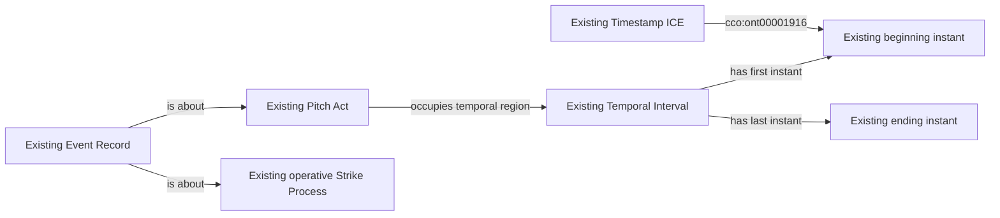

# P1: ordered count calculations with overlapping recorded pitch intervals

Status: **accepted October 12, 2026**. The user approved P1 together with F9 and M1. Implementation follows this decision record.

## Accepted decision

For count calculations, allow overlapping pitch intervals when both their
beginning instants and ending instants strictly increase in the same order,
and the independently reconciled source identities, pitch membership, final
calls and count transitions agree with that order. Every interval must still
have a supported beginning and end, with its end at or after its own beginning.

Equal beginnings, equal endings, nested/reversed ordering, missing or inverted
intervals and unresolved count/review transitions remain unsupported. Automatic
count awards retain their separately evidenced placement between pitches.

The consumer calculates a count sequence; it does not assert that one complete
pitch Process temporally precedes another. Preserve every RDF timestamp and
existing temporal assertion. Source counts certify the graph's completeness;
scores continue to come from the mapped pitches and operative strike Processes.
There are no new classes, properties, RML selections, source requests or rebuilds.

## Why this needs an explicit decision

The accepted [F8 contract](../mlb-game-foul-defense-selection-repair/README.md)
says to "still reject pitch-to-pitch overlap." P1 changes that analytical
ordering restriction only. It does not broaden F8's executable foul selector,
declare all overlap reliable, or replace the separate F9 selection proposal.

## Retained example and field inventory

Game 822755, PA 11 ends in a strikeout. The retained response has SHA-256
`25e20a67833e84aea36cdec41deaabace16d57d082c6867c3bb10df386ad681b`.
Its first two recorded intervals overlap, but both endpoint sequences and the
three final strike transitions agree:

| Pitch | Beginning UTC, 2026-04-06 | Ending UTC | Strikes after |
| --- | --- | --- | ---: |
| fe879f3c-c159-3dfb-a9b3-4f700ae2c416 | 23:09:42.194 | 23:09:46.604 | 1 |
| 170ffa6f-f43b-3dae-80e2-fc96c8b99145 | 23:09:42.236 | 23:10:01.286 | 2 |
| 4daac1d1-4715-33af-916a-b7bcd340bb52 | 23:10:12.426 | 23:10:17.406 | 3 |

The response is retained under the game's `targeted-history-4cfefc9c4429ad76`
quarantine input. Its bytes remain unchanged. Event identifiers, recorded
intervals, calls and counters are already supplied by the owning MLB game lane;
no additional field is selected. Counters remain admission inputs, not scores.

The example contributes zero nonterminal extension pitches after strike two.
Acceptance does not certify the remaining season count population or any absent
strike mapping.

This diagram restates existing graph structure. Ordering is a query over the
recorded instants; it adds no edge between Pitch Acts.

After approval, update the existing count admission and Recovery reader, retain
successful earlier evidence with its original producer, exercise an overlapping
example and a conflicting-endpoint example, and let NiFi refresh affected
negative evidence and derived products. Do not regenerate RDF.
