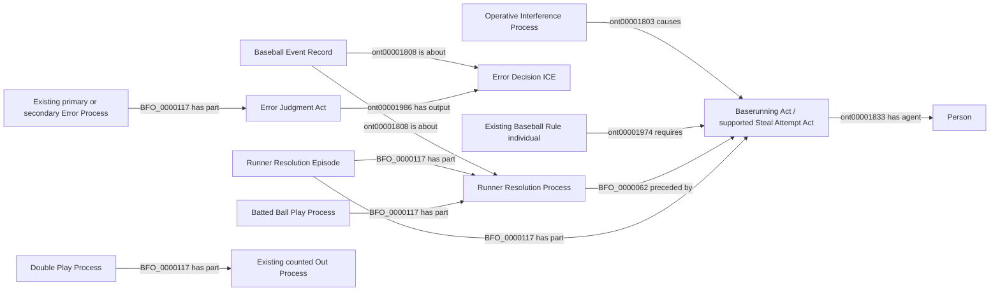

# EG6: remaining Empty Games attribution and selection boundaries

Status: **under review**, October 11, 2026. No implementation or approval is
implied. No ontology terms, object properties, source endpoints, new lifecycle
or full rebuild are proposed. This package separates three decisions; they can
be accepted independently.

The measured publication has 628 complete hitters of 662, with 35 held
player-games in 33 games. The published EG5 fixes independently address dropped
ball credits, distinct secondary errors and explicit RBI credit. This package
addresses the remaining shared boundaries, not one mapping per game.
The [retained evidence](evidence.json) identifies actual cases and source hashes.
Execution-context excerpts are diagnostic evidence, never ingestion inputs.

## EG6A: contribution from an explicitly error-classified step

Proposed Empty Games rule: an operative, explicitly error-classified advancement
step supplies no new batting or running positive, even when it occurs within a
batted-ball play. This refines EG5's unresolved mixed contact/error boundary; it
does not assert that the error was the only physical cause. Mere membership in
a contact play does not establish independent positive credit for that step.
Keep any separately supported safe contact step, independent running step or
eligible explicit RBI credit. Apply terminal-out coalescence as before.

Example: a runner reaches second on a single and then third on an explicitly
scored throwing error. Preserve the single's supported contribution; the extra
error-classified step adds none. A runner's error-only advance cannot keep that
runner out of Empty Games. Error/FC/interference batting exclusions remain.

Require the existing primary or secondary Error Process, judgment, decision
and its exact runner-record/resolution association. A missing classification,
ambiguous correction, unspecified advance or missing history remains unknown.
This decision introduces no speed inference and no numeric progress weight.

Witness families: 822945/61, 823623/34, 824018/86, 824429/18, 824576/9,
824744/58 and /65, 825062/87; mixed contact continuations also appear below.

Competency answers requested: does a known error-classified step itself create
a positive? **No.** Does an error erase a separate positive? **No.** Does this
classify physical causation or make an unclassified advance zero? **No.**

## EG6B: the actual contributor in a substituted batting turn

Proposed Empty Games rule: a replaced batter's earlier participation in the
count does not itself earn credit for a replacement's later walk or contact
result. Credit the supported award recipient or actual contact batter. Preserve
the replaced player's own independently supported batting/running positives.
Official PA attribution remains the separate, approved EG4 scoring decision.

Witnesses: 823533/27 and 823883/58 have an outgoing batter who saw pitches and
an incoming batter who receives the walk. 823927/46 has a replacement making
the terminal bunt. This decision settles the earlier batter's contribution;
it does not remove their actual Batter Act or transfer their official PA.

Competency answers requested: does count participation alone make the outgoing
batter positive for the replacement's result? **No.** Are official PA credit,
actual participation and positive contribution distinct? **Yes.** If the
terminal actor/award recipient cannot be reconciled, may one be guessed? **No.**

## EG6C: generic remaining source selections and a bounded census exception

Approve the following generic selections over existing patterns. Apply them to
future MLB Game inputs and only matching held player-games in the existing EG1
repair inventory. Every selection retains exact identities, reviewed histories,
operative reviews, source consistency and applicable source-owned SHACL.

| Pattern and witness | Exact proposed selection |
| --- | --- |
| Contact following extra-inning placement: 824158/76, 824402/83, 824025/83 | A pre-pitch placement must already reconcile through the accepted C3 placement judgment and runner history, with the same incoming runner and base. Permit the later B2 contact continuation. Placement remains a distinct adjudicated event, not contact or positive running. |
| Mixed contact/error continuations: 823208/29, 823988/6, 824622/66 | Permit complete B2 terminal membership when the unique operative in-play event and full C1 paths reconcile, including separately classified error segments and all terminal outs. Mere shared event index remains insufficient. Separate physical play membership from EG6A's analytical credit; do not erase error classifications or credit an advance consumed by an out. |
| Two-step defensive indifference: 823894/78 | Select an explicit `defensive_indiff` action and matching same-runner rows forming one unique forward, contiguous safe path. The first row must use `r_defensive_indiff`; a subsequent `r_adv_play` row at that same action may continue it. No error, award, contact, out or conflicting review. Reuse each existing act/episode; add existing `StealAttemptAct` typing, not official stolen-base credit. |
| Non-contact advance during another runner's pickoff/caught-stealing event: 823134/48, 825010/27 | Reconcile the explicit action, exact runner rows, start/end bases, outs and final occupancy. Add `StealAttemptAct` only to positively supported actual advancing acts without batted-ball advancement; do not label another runner caught merely from the shared event code. An explicit error credit is separately classified and follows EG6A. |
| Safe advance on a blocked terminal strike: 824105/69 | Require an explicit non-in-play third-strike event, a separately recorded existing runner's safe advance, complete C1 history and reconciled terminal outs. Reuse the existing actual act as `StealAttemptAct` under its broad accepted definition. Do not invent a passed ball, wild pitch, official steal or batter contribution. |
| Error attribution without a separate error event label: 823373/17; primary-error continuation: 822934/26 | A unique explicit fielder/error-kind credit and reconciled affected runner row may supply the EG5 scoring association even when the event label describes the pickoff attempt. For a continuation of the one primary error, associate the affected record with the existing primary Error Process/judgment/decision rather than minting a second error. Distinct explicit secondary errors retain their existing identity. Ambiguous error identity stays unresolved. |
| Forced advance on operative catcher interference: 823003/88 | Require an operative, reconciled interference judgment, the identified batter's award to first, explicit pre-event occupancy and the complete one-base force chain with matching final endpoints. Reuse the existing rule-required award/actual-running pattern for forced runners. Exclude an accepted alternative play, voluntary extra advance or inconsistent occupancy. This is neither independent-running nor positive batter credit. |
| Sacrifice-fly double play: 824622/54 | Reconcile the explicit compound result, unique contact event, counted run, two distinct numbered outs, and existing judgments. Represent the existing Sacrifice Fly classification and Double Play whole with the existing counted-out parts; do not infer a physical catch or intentional sacrifice. Explicit eligible RBI credit remains independent. |
| Missing inning total in a called final game: 824295/79-80 | Retain the missing inning-total diagnostic and withhold totals-dependent products. For Empty Games only, permit a separate complete resolution census when the final game's full completed-PA inventory, official player PA totals, every explicit runner row, per-play cumulative scores, final team scores and existing RDF all reconcile. Do not fill the missing total, claim global source completeness, admit an incomplete play or ignore a source/graph mismatch. |

The last item explicitly refines Q6's earlier metric-population withholding.
824295 is marked `Completed Early: Rain`; both final PAs are complete, and the
ninth-inning run field is absent. It is not permission to treat null as zero.

These are selections, not additional ontology universals. The existing
`StealAttemptAct` definition concerns directed advancement without relying on
batted-ball advancement; its use here requires this review and does not change
its definition. General running/award cases outside the exact conditions remain
unresolved. The new census branch must preserve every existing source diagnostic.

## Source-independent shapes and field inventory

This diagram contains distinct conditional branches, not a claim that every
act is an error, contact member or award. Existing placement and scoring
judgment patterns remain intact. Analytical contributions are calculated from
these graphs; no metric predicate, literal or new class is introduced.

| Fields | Classification | Use |
| --- | --- | --- |
| Game/PA/event/runner identities, original indexes and player IDs | Identity/join-only, already supplied | Preserve exact existing identities and associations |
| Pitch/call/in-play flags, actions, row event types and movement reasons | Already supplied; coverage debt | Select the concrete event and distinguish contact, running and awards |
| Row starts, ends, out numbers, scoring flags, final occupancy | Already supplied | Reconcile complete paths and operative outcomes |
| Explicit fielder/error-kind credits, RBI flags and official totals | Already supplied; coverage debt | Existing scoring decisions, never inferred physical failure |
| Substitutions and per-event batter participation | Already supplied | Separate actual participant, recipient and official credit |
| Game status, completed plays, inning totals and cumulative/final scores | Already supplied | The narrowly scoped census exception; preserve missing fields |
| Exact physical cause, runner intent, unreported WP/PB, missing total | Unresolved | Do not invent |
| Expected force-chain and path consistency | Deterministically derivable checks | Select already observed facts, never generate missing movements |

No new provider or duplicate source authority is needed. MLB's rules distinguish
official stolen-base credit from other advancement (9.07), error scoring (9.12),
RBI credit with errors (9.04), and forced advancement on interference
(5.06(b)(3)(D), 6.01(c)). Those distinctions support the source interpretation;
the custom Empty Games choices in EG6A/B remain the user's decisions.
[2026 Official Baseball Rules](https://mktg.mlbstatic.com/mlb/official-information/2026-official-baseball-rules.pdf).

## Implementation after named acceptance

Publish each accepted decision in a separate record before implementation.
Reuse the existing context/RML, source-owned SHACL and NiFi repair owner;
update only affected semantic pins and proof dependencies. Add only missing
facts and required existing-pattern dependencies. Preserve unrelated RDF and
raw inputs. Use retained originals or the already bounded EG1 recovery scope,
never reconstructed execution contexts as inputs. No per-game special cases,
whole-game replacement, new gate or rebuild.

Refresh affected SPARQL-derived prepared results through NiFi. Measure the
resulting dashboard population; do not report a projected gain as a completed
player. Unknowns outside these explicit decisions remain visible.
