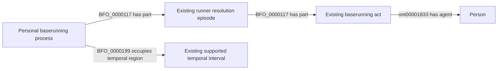

# H5: align targeted history repair with the accepted current source selectors

Status: **under review**, October 12, 2026. No approval is implied.

## Decision requested

Allow the existing H3 history repair owner to use the current, already accepted
MLB context when diagnosing and adding missing C1 histories. This extends the
execution scope of EG2's accepted uncaught-strike placeholder reconciliation
from the Empty Games repair inventory to specifically identified history gaps.
It does not change that reconciliation rule, C1 identities, source clocks,
ontology vocabulary or an analytical metric.

The current context is SHA-256
`11110d7c5b51b4902093652abdb6c4dd34f9449f97b98ac2d2b41cc5dbe2e0cb`.
The source runtime already admits it following EG6. H3 separately pins the
older context `e3bf6ebedca0f6dcd80727d8250eb7d1d58076e0dd85f100df21fb7cbf0242b0`
from commit `45e4df6607a1dabeae2967c47fb1806f0af18fa1`.
Comparing the complete transitive history function definitions finds one
changed function: `nonmovement_strikeout_records`, accepted in EG2. Unrelated
context constants/imports also changed. The old H3 compatibility check therefore
correctly refuses the new context; it is not evidence of damaged RDF.

Approve replacing only the H3 execution pin and its transitive signature with
those of this exact accepted context. Preserve the prior pin in Git and its
original validation provenance. No semantic-freeze or ontology file changes.
The prepared [pin change](selection.patch) is inactive until acceptance.

## Targeted execution and witnesses

The September 30 decisions already authorize NiFi to acquire an identified
game's existing endpoint when a repair's retained input is unavailable. Each
repair request must name the current promotion and recorded history failure
before acquisition. Keep the response's real hash, reconcile existing history
identities and select only missing accepted histories and their dependencies.
Unchanged, fully admitted histories need no source request. Changed identities,
unsupported transitions and inverted intervals remain withheld.

Three current witnesses show why a completed narrow repair is not complete
game coverage:

| Game | Completed repair | Separate recorded gap |
| --- | --- | --- |
| 822685 | October 1 addition of one eighth-inning bottom-half history | Scoring episode 17/2 exists without its C1 whole; retained boundary census also records unresolved second-inning histories |
| 822732 | October 1 addition of four eighth-inning top-half histories | Current scoring-history reader still has an unresolved history; original raw input has been retired |
| 822754 | October 1 addition of three sixth-inning top-half histories | Current scoring-history reader still has an unresolved history; original raw input has been retired |

These are discovery witnesses, not fabricated completed selections. The source
owner must identify exact missing histories against the current graph before
RML execution. The generic queue correction permits discovery after a completed
fixed repair and selects a new recorded job ahead of its old fixed-list entry.
It neither reopens that completed job nor declares the whole game admitted.

## Existing graph contract and inventory

The accepted C1 source contract supplies actual types, identities and exact
temporal relations; this diagram introduces none. No new object properties.

| Input | Selection |
| --- | --- |
| Game, play, episode, runner and lifetime identifiers | Existing identity/join facts; preserve all identities |
| Runner movements, source counters, reviews and timestamps | Already supplied by the owning MLB Game source; existing accepted selectors only |
| Missing history membership | Existing C1 mapping coverage debt; add only selected facts |
| Missing raw response | Operational recovery under September 30 answer 1; never reconstruct it from a validation census |
| Unexplained transition or invalid time | Unresolved; no replacement value or inferred movement |

Competency answers requested: may the existing history owner reuse the exact
accepted EG2 selector? **Yes.** Does earlier completion prove all other histories
complete? **No.** May it replace a game or rebuild the season? **No.** May it
relabel an old proof as current? **No.**

After named acceptance, publish the decision first, apply the scoped pin change,
run the focused history-worker checks and let NiFi perform bounded discovery,
existing SHACL and additive promotion. Empty Games publication is independent.
This does not authorize F9, M1, P1 or use missing internal timing as a valid
whole-history endpoint.
